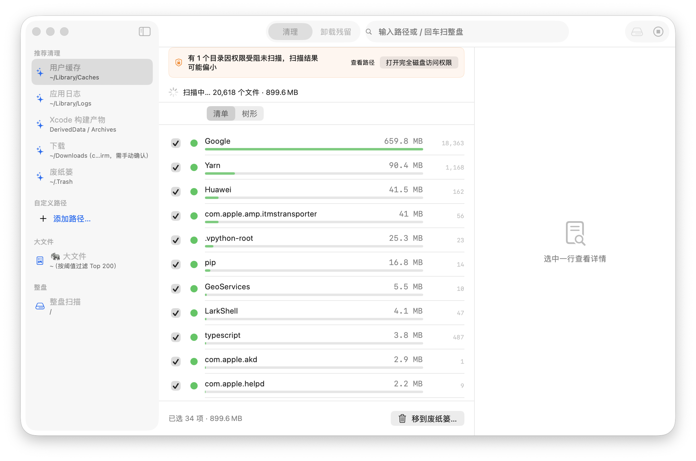
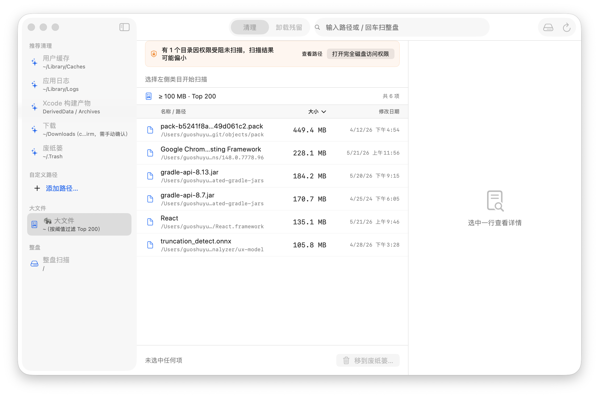
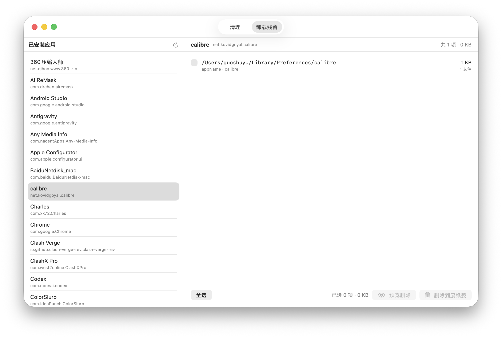
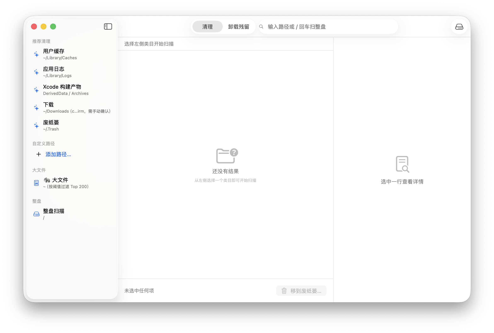

<div align="center">


# GSYCleanMac

**面向 macOS 的开源、可审计、安全清理管家。**

[English](README.en.md) | 简体中文

[](LICENSE)
[](docs/INSTALL.md)
[](https://swift.org)
[](#质量与安全)
[](#多语言)

[下载最新版](https://github.com/CarGuo/GSYCleanMac/releases/latest) ·
[安装指南](docs/INSTALL.md) ·
[安全模型](SECURITY.md) ·
[路线图](docs/ROADMAP_V1.md)

</div>

---

## 它能为你做什么

- 一键找出 Mac 里**真正能删的垃圾**：用户缓存、应用日志、Xcode 构建产物、下载历史、废纸篓。
- **找回被代码项目偷走的硬盘**：识别 Android / Flutter / iOS / RN / Electron / Rust / Go / Python 等十多种生态的 build / node_modules / target / .gradle / DerivedData。
- **一目了然看大文件**：≥100 MB Top 200 一屏看完，按大小或修改日期排序。
- **彻底卸载残留**：选中已安装 App，自动列出它在系统各处留下的配置 / 缓存 / Preferences / Group Containers。
- **管理启动项**：列出 LaunchAgents / LaunchDaemons，开关一目了然。
- **删除安全可逆**：所有删除统一走废纸篓，永远不调用 `unlink(2)`，误删随时撤销。

---

## 截图

<table>
  <tr>
    <td align="center" width="50%">
      <br/>
      <sub><b>推荐清理</b>：选中类目实时扫描，三色徽章标注安全度，按物理占用降序</sub>
    </td>
    <td align="center" width="50%">
      <br/>
      <sub><b>大文件</b>：≥100 MB Top 200 一屏看完，名称 / 路径 / 大小 / 修改日期四列排序</sub>
    </td>
  </tr>
  <tr>
    <td align="center" width="50%">
      <br/>
      <sub><b>卸载残留</b>：识别已安装 App 在系统各处的配置 / 缓存 / Preferences 残留</sub>
    </td>
    <td align="center" width="50%">
      <br/>
      <sub><b>主界面</b>：推荐清理 / 自定义路径 / 大文件 / 整盘 / 开发者构建产物 五类入口</sub>
    </td>
  </tr>
</table>

> 想自己复现这些截图？跑一次 `./Scripts/screenshots.sh` 即可。

---

## 我们做什么、不做什么

**做的**

- 本地扫描磁盘占用、定位大文件、清卸载残留、识别启动项、检测重复文件、扫描开发者构建产物。
- 一切删除走废纸篓，可撤销。

**不做的**

- 网络流量监控、伪「内存释放」、伪「启动加速」、浏览器历史清理。
- 订阅、遥测、广告、捆绑安装。

为什么不做？详见 [PITFALLS.md](PITFALLS.md) 和 [SECURITY.md](SECURITY.md)。

---

## 多语言

支持 **简体中文** 与 **English**，跟随系统语言自动切换。也可以在系统设置里给单个 App 单独指定语言。

---

## 安装

最快路径：

1. 去 [Releases](https://github.com/CarGuo/GSYCleanMac/releases/latest) 下载 `.dmg` 或 `.app.zip`。
2. 拖入 Applications，首次启动按系统提示「仍要打开」。
3. 在「系统设置 → 隐私与安全 → 完全磁盘访问」里把 GSYCleanMac 勾上，让它能扫到 `~/Library` 下的内容。

完整安装、TCC 授权、签名校验步骤见 [docs/INSTALL.md](docs/INSTALL.md)。

> 维护者本地 release 走 **Developer ID Application 签名**，可按需执行 Apple Notary 公证；GitHub Actions 的公开 workflow 仍保留无私钥的 ad-hoc 产物路径。当前发布模式和校验边界见 [docs/RELEASE.md](docs/RELEASE.md)。

---

## 质量与安全

- **370+ 单测、5 个独立 SPM 包**：[ScanKit](Packages/ScanKit) / [SafetyKit](Packages/SafetyKit) / [HeuristicKit](Packages/HeuristicKit) / [TestHarness](Packages/TestHarness) / [AppUI](Packages/AppUI)。
- **三档安全引擎**：每条删除候选都过 `safe / confirm / forbid` 三色判定，规则在 [vendors.yaml](Resources/Rules/vendors.yaml) 公开可读。
- **TCC 高敏目录硬 skip**：Mail / Messages / Calendars / Photos Library 等永远不进入扫描候选，从源头规避「删用户邮件」类事故。
- **端到端集成测试钉契约**：[V12SafetyIntegrationTests](Packages/AppUI/Tests/AppUITests/V12SafetyIntegrationTests.swift) 把「不许删什么」写成断言。
- **永不 `unlink(2)`**：所有删除路径都强制 `NSWorkspace.recycle()` 移废纸篓。

完整威胁模型见 [SECURITY.md](SECURITY.md)。

---

## 自己跑起来

```bash
git clone git@github.com:CarGuo/GSYCleanMac.git
cd GSYCleanMac
./Scripts/setup_dev.sh
```

> **fork 用户必读**：[GSYCleanMac.xcodeproj/project.pbxproj](GSYCleanMac.xcodeproj/project.pbxproj) 当前 Debug 走 `Automatic + Apple Development`，Release 走 `Manual + Developer ID Application: SentenceEnd Inc (W6H34N9728)`。第一次 build 必须改成你自己的 Team / signing 配置。详见 [docs/DEVELOPMENT.md](docs/DEVELOPMENT.md) "签名配置" 段。

```bash
xcodebuild -project GSYCleanMac.xcodeproj -scheme GSYCleanMac -configuration Debug build
```

完整开发环境、签名、调试技巧见 [docs/DEVELOPMENT.md](docs/DEVELOPMENT.md) 与 [CONTRIBUTING.md](CONTRIBUTING.md)。

---

## 路线图

| 版本 | 主题 | 状态 |
|---|---|---|
| v1.0 | 整盘扫描 / 推荐清理 / 大文件 / 卸载残留 / SafetyEngine 三档 | 已发布 |
| v1.1 | 应用占用 / 启动项 / TCCSkipList / 修改日期过滤 / 自动检查更新 | 已发布 |
| v1.2 | 类型分桶 / Quick Look / 导出 / 重复文件检测（只读） | 已发布 |
| v1.3 | 灵动岛 HUD / 状态栏托盘 / 设置面板重构 | 已发布 |
| v1.4 | 开发者构建产物扫描（Android / Flutter / iOS / RN / 等 12+ 生态）| 已发布 |
| v1.5 | 树视图增量化（O(N flat) prune patch + 原生 String 路径切分 + DirIndex 祖先对称减法 + store 错误日志化）| 已发布 |

详见 [docs/ROADMAP_V1.md](docs/ROADMAP_V1.md)。

---

## 文档地图

| 文档 | 内容 |
|---|---|
| [docs/INSTALL.md](docs/INSTALL.md) | 安装、Gatekeeper、TCC 完全磁盘访问授权 |
| [docs/RELEASE.md](docs/RELEASE.md) | 发布流程、Developer ID、公证/不公证模式、CI tag 触发 |
| [docs/DEVELOPMENT.md](docs/DEVELOPMENT.md) | 开发环境、构建脚本、本地调试 |
| [docs/DEV_ARTIFACTS_RULES.md](docs/DEV_ARTIFACTS_RULES.md) | 开发者构建产物扫描规则与拓展 |
| [docs/FEATURE_GAP.md](docs/FEATURE_GAP.md) | 与同类产品 23 维 × 8 家竞品对比 |
| [docs/ROADMAP_V1.md](docs/ROADMAP_V1.md) | 版本规划与每个里程碑的范围 |
| [SECURITY.md](SECURITY.md) | 威胁模型、Hard Rules、漏洞上报 |
| [PITFALLS.md](PITFALLS.md) | 同类项目踩过的坑总览 |
| [CONTRIBUTING.md](CONTRIBUTING.md) | PR 红线、commit 规范 |

---

## 致谢

致谢同类开源项目 [Pearcleaner](https://github.com/alienator88/Pearcleaner) 在 TCC skip / vendor 规则维护上的实践参考。规则文件全部独立清洗，未引用任何竞品源码。

---

## License

[MIT](LICENSE) · Copyright (c) 2026 CarGuo
