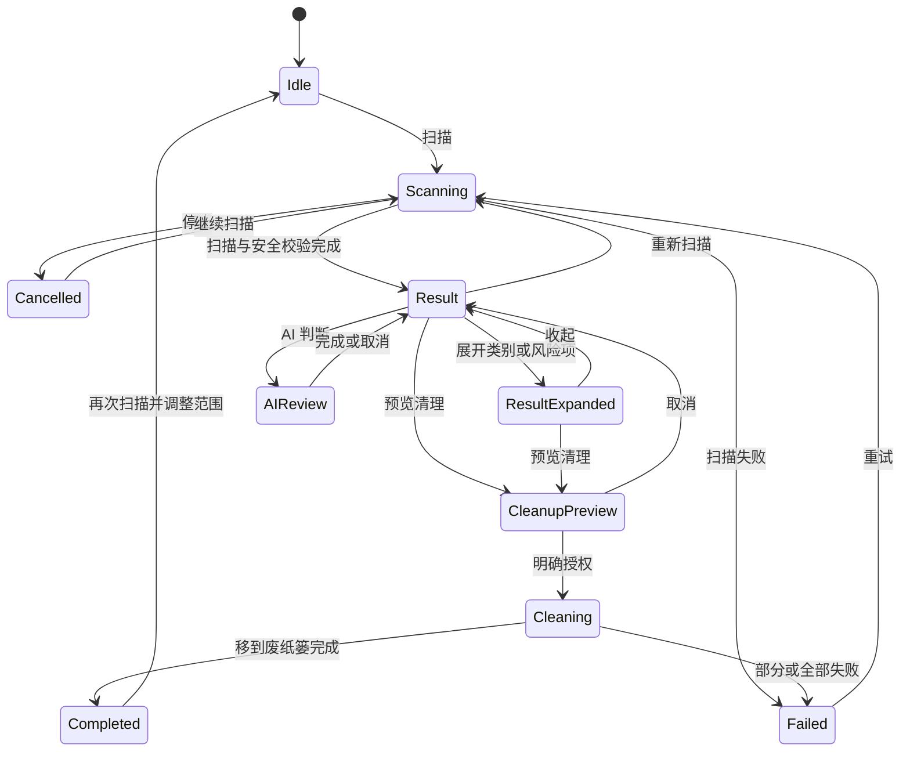

# Smart Care 普通模式 UI / UX 总体设计

> 设计冻结日期：2026-07-12
> 状态：正式 UI 已落地；Normal / Professional 隔离合同已冻结
> 参考：用户提供的 Smart Care 动图只借鉴“单一主动作、状态换场、过程持续反馈”，不复制竞品配色与信息架构
> 本文替代 2026-07-09 版本；旧版“普通 / 专业联动、切换后复用结果”的合同全部作废
> 可交互原型：[smart-care-normal-flow.html](./prototypes/smart-care-normal-flow.html)
> 验证日期：2026-07-12；9 个 Swift 包测试通过，5 个扫描 / HUD / 树 / dry-run 真机回归通过

---

## 0. 一句话目标

普通模式是一条独立的懒人流程：打开后只看到一个主扫描动作和三个可选扫描范围，扫描中持续看到真实状态，完成后先看简要结果，需要时再展开逐项勾选，任何清理都必须经过用户明确授权。

专业模式继续服务开发者和高级用户。两种模式只共用底层安全能力，不共享工作流状态，也不互相跳转。

---

## 1. 不可变更的产品合同

### 1.1 Normal 与 Professional 完全独立

| 边界 | Normal | Professional |
|---|---|---|
| 扫描会话 | 独立 `SmartCareSession` | 现有专业 `ScanCoordinator` |
| 扫描结果 | 只保存在 Normal | 只保存在 Professional |
| 勾选状态 | `SmartCareSelection` | 现有专业 selection / stash |
| 当前页面 | Normal 自己记忆 | Professional 自己记忆 |
| AI 运行状态 | Normal 自己维护 | 专业 AI 操作自己维护 |
| 模式切换 | 只切换可见界面 | 只切换可见界面 |

明确禁止：

- Normal 扫描开始时清空 Professional 的 `selectedCategory`、selection、结果或树状态。
- Normal 复用 Professional 正在发布 UI snapshot 的 coordinator。
- Normal 的“详情”按钮自动切换到 Professional。
- Professional 扫描完成后自动刷新 Normal 摘要。
- 模式切换时复制、合并或重新默认勾选另一模式的结果。

允许共用的只有无状态或基础设施能力：

- `SafetyEngine`、规则仓库、路径保护和硬禁止策略。
- `TrashPipeline` 与 `NSWorkspace.recycle`。
- 语言、外观、隐藏文件、开发规则开关等用户设置。
- 只用于避免同时重压磁盘的资源调度器；它不得传递结果或选择。

### 1.2 安全优先

- `safe` 默认勾选，用户可取消。
- `confirm` 默认不勾选，用户可展开后主动选择，并立即看到风险提示。
- `forbid` 永不可选，只显示“已保护”。
- AI 只能追加建议，不能修改本地 verdict，不能自动勾选，也不能覆盖 `.forbid`。
- 点击结果页主按钮只进入清理预览，不执行文件改动。
- 真正处理必须再次明确授权，且只走 `TrashPipeline -> NSWorkspace.recycle`。
- 默认始终为 dry-run；没有用户授权时绝不移动任何内容。

### 1.3 普通模式只展示已支持能力

首版只出现三个真实扫描类别：

1. 系统日志。
2. App 缓存。
3. 开发缓存。

大文件、App 残留、重复文件在普通模式能力接通前完全不显示，不出现占位卡、0 KB 卡或“前往专业模式”提示。

---

## 2. 顶层信息架构

顶部工具栏固定顺序：

```text
[AmuxAIClean]   [Normal | Professional]
```

- 品牌在前，模式切换在后。
- Normal 不显示专业搜索、排序、购物车和扫描工具。
- Professional 保持现有专业工具栏。
- 切换模式后返回时，各自恢复离开前的页面、扫描状态和选择。
- Normal 内所有展开、风险确认和清理预览都在 Normal 内完成。

---

## 3. Normal 完整状态流



状态必须换场，不允许把 idle、扫描进度、结果卡片和清理状态同时堆在一个长页面里。

---

## 4. 页面设计

### 4.1 Idle：一个主动作，三个可选范围

目标：用户无需阅读说明就知道可以开始。

画面：

```text
┌─────────────────────────────────────────────────────┐
│ AmuxAIClean   [ Normal | Professional ]             │
├─────────────────────────────────────────────────────┤
│                                                     │
│                    [动态扫描核心]                    │
│                         ◉                           │
│                       扫描                          │
│                                                     │
│   [✓ 系统与日志]   [✓ 应用缓存]   [✓ 开发缓存]      │
│                                                     │
└─────────────────────────────────────────────────────┘
```

- 只有一个主命令，不出现结果数字、风险数字或专业配置。
- 三个范围默认全选，用户可在扫描前任意取消；全部取消时主按钮禁用。
- Developer Cache 使用独立时钟徽章提示“可能较慢”；该提示只表达耗时，不表示风险更高。
- 范围选择决定真实扫描计划，不允许只隐藏 UI 而后台仍扫描全部目录。
- 中央扫描核心约 270 pt，扫描按钮约 144 pt。
- 扫描按钮与动态轨道叠合成一个完整主视觉，而不是上下两个孤立控件。
- 按钮包含放大镜图标和“扫描”，支持 Return。
- 背景使用低对比扫描网格和合成层扫光，不能影响文本对比度。
- 三个扫描范围使用同一视觉语法下的不同切角轮廓；入场依次展开，悬停轻抬，勾选时边缘强调与符号同步反馈。
- 仅 Idle 背景出现两条低透明度粒子鱼：保留参考示例的 10000 点、奇偶分鱼和 XOR 鳞片算法，并让鱼群中心沿缓慢双轴轨迹游遍可用背景。
- 第一条鱼使用蓝 -> 青绿，第二条使用青绿 -> 琥珀；点击扫描后两条鱼淡出，不进入 Scanning、Result、Cleaning 或 Completed。

### 4.2 Scanning：同一主视觉自然变形

目标：始终回答“正在做什么”和“已经发现多少”，不让数字停住后像卡死。

- 仅扫描态在底层出现低透明度彩色火焰场，提取参考 shader 的上升、扭转和多色流动特征，但不遮挡容量、阶段和停止操作。
- 火焰在进入扫描时淡入，离开扫描即停止发射并快速退场；Idle、Result、Completed 不显示火焰。
- 火焰不照搬参考示例的青紫粉配色，而是与进度环共用蓝 #247AFA、青绿 #17B08F、琥珀 #F29429 三色；同一状态语义只保留一套颜色来源。
- 火焰直接移植参考 `fire.frag` 的 `70 x 6` raymarch 算法，通过多通道亮度提取把原 shader 的深蓝底还原成透明负空间，仅保留会流动的火舌与卷曲纹理；背景强度上限为 `0.24`，不再使用会形成圆形色块的椭圆遮罩。
- 火焰由独立高优先级 Metal 渲染线程稳定提交，主线程只切换显隐状态；扫描期暂停横向扫光，避免两套背景运动互相争抢注意力。
- 目标 60 FPS，内部渲染比例 `0.18`、最长边上限 `640 px`、最多两帧在途；偶发延迟时单帧模拟步长限制为 `1/30 s`，宁可轻微减速也不让形态瞬移。

画面：

```text
                    ╭────────────╮
                 ╭──│  品牌图形  │──╮
                 │  │  18.5 GB   │  │  旋转扫描环
                 ╰──│ 当前安全量 │──╯
                    ╰────────────╯
                     正在扫描 App 缓存

          ✓ 基础检查 ── ● App 缓存 ── ○ 开发缓存 ── ○ 安全校验

                             [停止]
```

最多四个阶段；未选择的范围完全不出现：

1. 基础位置。
2. App 缓存。
3. 开发缓存。
4. 整理与最终安全校验。

行为规则：

- 容量始终标记为“当前发现的安全容量”，不是最终值。
- 扫描器不再读盘但仍在聚合时，标题必须切成“正在整理结果”。
- 最终 verdict / 去重仍在计算时，标题必须切成“最终安全校验”。
- 整理和校验阶段扫描环继续运动，禁止出现“数字停住、界面没有说明”的空窗。
- 数字按 150-250 ms 节流更新，不跟随每个文件事件刷新。
- 停止只停止 Normal 会话，不影响 Professional。

### 4.3 Result：先给结论，再给控制

目标：默认一眼看到安全可清理量，同时有明确的重新扫描和逐项控制入口。

画面：

```text
[↻ 重新扫描]

                       49.7 GB
                     安全可清理
                       扫描完成

┌─────────────────────────────────────────────────────┐
│ ☑  系统日志                              535.9 MB  › │
├─────────────────────────────────────────────────────┤
│ ☑  App 缓存                               18.5 GB  › │
├─────────────────────────────────────────────────────┤
│ ◩  开发缓存                        28.1 / 30.6 GB  › │
└─────────────────────────────────────────────────────┘

  △ 21.4 GB 需要确认        ◈ 164 KB 已保护

       [预览清理]       [AI 判断]       [风险项 ›]
```

- “重新扫描”是结果页首屏明确可见命令；点击后先回到范围选择，不立即开扫。
- 只显示有结果的受支持类别。
- 容量摘要固定在选择区上方，操作栏固定在下方；展开和滚动不会让“已选多少”与“下一步”消失。
- 类别头使用三态选择：全选、部分选中、全不选。
- 类别容量在部分选择时显示“已选 / 总量”。
- 结果页不显示路径、规则命中、长风险说明。
- 风险项在 Normal 内展开，不跳转 Professional。
- 主按钮固定叫“预览清理”，不使用会暗示立即删除的文案。

### 4.4 展开勾选：渐进披露

每次只展开一个类别，避免页面同时出现数百行。

```text
┌─────────────────────────────────────────────────────┐
│ ◩  App 缓存                         12.8 / 18.5 GB  ⌄│
├─────────────────────────────────────────────────────┤
│ ☑ Google                                      8.1 GB │
│ ☑ WeChat                                      3.4 GB │
│ ☐ Chrome                                      2.7 GB │
│ ☑ JetBrains                                   1.2 GB │
│                      ↕ 可滚动，最大高度 240 pt       │
└─────────────────────────────────────────────────────┘
```

- 展开区使用 `LazyVStack`，最大高度 240 pt，列表自身可滚动。
- 展开后顶部容量环收敛为紧凑横向摘要，为逐项列表让出垂直空间；收起后恢复完整结果环。
- 每行只显示复选框、名称、容量；不显示完整路径。
- 类别很多时仍渲染可见行，不一次构建全部 SwiftUI row。
- 点击类别标题或 chevron 展开；点击三态 checkbox 只改变全选状态，不触发展开。
- 逐项取消后，顶部总容量、类别已选容量和清理预览同步更新。
- 展开状态只属于 Normal，不影响 Professional 的树展开状态。

### 4.5 需要确认与已保护

“需要确认”是独立 disclosure section：

- 默认收起、默认不选。
- 展开后每行显示名称、容量、单行风险原因和 checkbox。
- 第一次选择 confirm 项时显示内联黄色提示，不弹阻断式大对话框。
- 只要选中 confirm，主按钮仍为“预览清理”，预览页再集中确认。

“已保护”只提供只读展开：

- 不显示 checkbox。
- 只显示名称、容量、被保护的短原因。
- AI 不得把它变成可选。

### 4.6 AI 判断

- 结果页始终显示 AI 判断按钮。
- 未配置：弹出原生提示，提供“打开设置”和“取消”。
- 已配置：按钮原位变为进度，不新开遮挡结果的全屏 HUD。
- AI 分批判断当前 Normal 结果，只发送判断所需元数据，不读取文件内容。
- 可取消；失败项单独标识，不让整批结果消失。
- 每个条目只追加“AI 建议安全 / 复核 / 避开”短标识。
- AI 完成后显示一行汇总；不自动改变选择。

### 4.7 清理预览与授权

点击“预览清理”后进入 Normal 自己的 sheet：

1. 顶部显示已选项数、文件数、容量。
2. 列出运行中 App 冲突和 confirm 风险。
3. 默认 `Preview only (dry-run) = ON`。
4. dry-run 不改变文件，只输出将处理与将跳过的结果。
5. 用户关闭 dry-run 后，最终动作必须使用破坏性样式，并再显示一次明确授权确认。
6. 没有最终授权不得进入 `.cleaning`。

请求必须是打开 sheet 时冻结的 selection snapshot，避免界面显示 X 项但执行另一份选择。

### 4.8 Cleaning：真实进度，不做假动画

```text
                    [品牌图形]
                 ╭──────────────╮
                 │  328 / 884   │  实际 batch 进度环
                 ╰──────────────╯
                    正在移到废纸篓
```

- 页面整体换场，不在结果页底部塞一条进度条。
- 动画使用实际批次完成回调；没有真实粒度时显示不确定环，不伪造百分比。
- 清理期间禁用模式切换中的破坏性命令，但仍可查看另一模式；不能启动第二个删除任务。
- 单项失败不会中断视觉反馈，完成页集中展示 moved / skipped。

### 4.9 Completed / Failed / Cancelled

Completed：

- 轻量 checkmark 动画。
- 只显示释放容量和移动项数。
- 主动作“再次扫描”，副动作“查看最近清理”。

Failed：

- 显示短错误结论和“重试”。
- 详细错误放在 disclosure，不占满首屏。
- 已成功移到废纸篓的内容不能被伪装成全部失败。

Cancelled：

- 显示“扫描已停止，未改动文件”。
- 主动作“继续扫描”，副动作“重新开始”。

---

## 5. 视觉系统

### 5.1 风格

- 原生 macOS、轻、安静、可信，不复制竞品紫色界面。
- 大面积使用系统 `windowBackgroundColor`，不铺全屏渐变。
- 主视觉来自品牌清理图形、扫描轨迹和真实状态变化，不靠装饰光球。
- 页面分区不做浮动卡片；只有结果列表、sheet 和重复条目使用 6-8 pt 圆角容器。
- 不嵌套卡片。
- 扫描范围是直接操作控件，可使用克制的不规则切角；不把其它页面分区普遍卡片化。

### 5.2 颜色

| 语义 | 建议色 | 用途 |
|---|---|---|
| 主动作 | 系统 Accent / `#0A84FF` | 扫描按钮、活动阶段 |
| 安全 | `#2FA45C` | safe、完成阶段 |
| 需确认 | `#E79A23` | confirm、风险摘要 |
| 已保护 | `#D94A4A` | forbid 图标，不大面积铺红 |
| 中性 | 系统 primary / secondary / separator | 文本、轨道、分隔线 |

颜色不能单独承担状态；必须同时有图标、文案或形状。

### 5.3 字体与尺寸

| 元素 | 规格 |
|---|---|
| 容量主数字 | 28-36 pt，rounded semibold，monospaced digit |
| 当前状态 | title2 semibold |
| 类别标题 | body medium |
| 行容量 | body / callout monospaced digit |
| 风险原因 | caption，最多两行 |
| 扫描按钮 | 104 x 104 pt |
| 扫描主视觉 | idle 196 pt；working 220-250 pt |
| 内容最大宽度 | 720-760 pt |
| 类别头高度 | 52 pt |
| 单项行高度 | 40-44 pt |

### 5.4 图标

- 系统日志：`trash`。
- App 缓存：`archivebox`。
- 开发缓存：`hammer`。
- AI：`wand.and.stars`，只用于 AI。
- 重新扫描：`arrow.clockwise`。
- 预览清理：`doc.text.magnifyingglass`。
- 真正移到废纸篓：`trash`。

禁止用 AI sparkle 图标代表系统垃圾或普通扫描类别。

---

## 6. 动效设计

| 场景 | 动效 | 时序 |
|---|---|---|
| Idle 呼吸 | 扫描核心外环 0.97 -> 1.035 -> 0.97 | 2.4 s，easeInOut，循环 |
| Idle 双鱼 | 两条粒子鱼内部摆动并沿全屏轨迹缓慢游动 | 60 FPS，Metal；离开 Idle 淡出 |
| 点击扫描 | 按钮缩至 0.96，品牌图形收进扫描环 | 120 ms + 320 ms spring |
| 双鱼 -> 火焰 | 背景场景交叉淡化 | 420 ms |
| 扫描环 | 90-110 度活动弧匀速旋转 | 1.6 s / 圈 |
| 阶段完成 | active spinner 变 checkmark，连接线染绿 | 220 ms |
| 数字变化 | `numericText` 内容过渡 | 180 ms，跟随节流快照 |
| 结果落位 | 活动弧闭合为 safe / confirm 分段环 | 360 ms spring |
| 类别展开 | 高度 + opacity，chevron 旋转 | 220 ms |
| 勾选变化 | checkbox + 容量数字同步 | 160-220 ms |
| Cleaning | 实际进度环 + 品牌图形轻微下沉 | 进度驱动 |
| Completed | checkmark 单次 draw / bounce | 420 ms，不庆祝式爆炸 |

性能约束：

- 动效只消费节流后的阶段 / 容量快照，不消费逐文件事件。
- 扫描中禁止排序大集合、重建完整列表或重复 SafetyEngine 评估。
- 扫描环的持续旋转与呼吸由 Core Animation 执行；火焰由独立 Metal 线程执行。二者都禁止用 `TimelineView` 高频重算 SwiftUI 视图树。
- Idle 双鱼复用同一 Metal 线程和渲染表面；不会新增 SwiftUI 逐帧状态，也不会与扫描结果发布争用主线程。
- 系统开启 Reduce Motion 后停止持续旋转、扫光和位移动画，仅保留静态状态差异。

---

## 7. HUD 与主窗口

- 主窗口是完整状态的唯一主界面。
- HUD 只做 companion：主窗口不可见、失去前台或用户明确启用常驻时出现。
- HUD 必须显示与所属会话完全相同的 phase、activity 和 safe bytes。
- HUD 不再有第二套“底部状态”；点击 HUD 只打开所属模式当前页面。
- HUD 可以观察 Normal 或 Professional 当前正在运行的任务，但不得把结果写进另一模式。
- 如果两个模式都请求磁盘重任务，资源调度器串行执行；HUD 标记当前任务来源，但不合并结果。

---

## 8. 工程边界设计

### 8.1 必须拆开的状态

```text
App
├─ NormalModeController
│  ├─ NormalScanCoordinator
│  ├─ SmartCareSession
│  ├─ SmartCareSelection
│  ├─ NormalAIReviewSession
│  └─ NormalCleanupPresentation
├─ ProfessionalModeController
│  ├─ ScanCoordinator
│  ├─ professional selection / stash
│  └─ professional navigation
└─ Shared services
   ├─ RuleRepository (read-only)
   ├─ SafetyEngine
   ├─ DiskWorkGate (resource only)
   └─ TrashPipeline
```

### 8.2 当前实现必须删除的联动

- `SmartCareSession.startScan(using: professionalCoordinator, ...)`。
- `startSmartCareScan()` 中的 `resetSelectionState()` 和 `selectedCategory = nil`。
- `openSmartCareDetails()` 中的 `interfaceMode = .professional` 与 `requestCategorySwitch(...)`。
- Normal / Professional 共用同一个 mutable scan snapshot。
- 托盘“推荐扫描”同时改变 Professional coordinator 和 Normal session 的合同。

### 8.3 清理边界

- Normal 与 Professional 可以复用 `TrashPipeline`，但请求类型和 presentation state 独立。
- 所有 Normal 清理请求由当前 Normal selection 生成不可变 snapshot。
- `forbid` 在 UI、request builder 和 `TrashPipeline` 三层都必须被拒绝。
- 清理成功后只更新 Normal summary，不 prune Professional 当前结果；Professional 下次刷新自行重新扫描。

---

## 9. 验收清单

### 9.1 UX

- [x] 新开窗口默认 Normal，首屏只有一个主扫描动作和三个可选范围。
- [x] 范围选择决定实际扫描阶段；未选择范围不会运行、不会出现在阶段条。
- [x] 点击扫描后发生完整换场，有连续动画、真实容量和明确阶段。
- [x] 聚合 / 最终校验期间不会看起来卡死。
- [x] 结果页首屏可见“重新扫描”。
- [x] 每个类别可展开、逐项勾选和取消；类别 checkbox 支持三态。
- [x] confirm 可在 Normal 内展开选择并看到风险；forbid 永不可选。
- [x] 未支持类别完全不出现。
- [x] AI 未配置会引导设置；已配置会对 Normal 当前结果运行并显示进度。
- [x] 预览清理不会改文件；真清理必须二次明确授权。
- [x] 清理中使用明确的不确定进度动画，不伪造批次百分比。
- [x] 完成、失败、取消都有独立简洁画面。

### 9.2 模式隔离

- [x] Normal 扫描不改变 Professional 的 category、snapshot、selection、tree 或 stash。
- [x] Professional 扫描不改变 Normal 的 phase、summary 或 selection。
- [x] 模式切换只改变可见页面；来回切换后各自状态保持。
- [x] Normal 没有任何按钮自动切到 Professional。
- [x] 两种模式的取消、重试和重新扫描只作用于自身会话。

### 9.3 视觉与性能

- [ ] 最小窗口与宽屏的完整截图矩阵仍需补齐；默认窗口和全屏已运行态检查。
- [ ] Dark Mode 的最终对比度复核仍需补齐；Light Mode 已运行态检查。
- [x] Reduce Motion 可用。
- [x] 扫描期主线程只发布轻量状态，UI 快照间隔不低于 150 ms。
- [x] 大结果集使用 Lazy 容器，并限制展开视口，不一次构建全部行。
- [x] 扫描环使用 Core Animation，火焰使用独立 Metal 渲染线程；Smart Care 不再包含扫描态 `TimelineView`，Metal 提交也不占用主队列。
- [x] 彩色火焰只在扫描态运行；Reduce Motion 下停止发射并保留低对比静态色场。
- [x] 双鱼只在 Idle 运行，使用参考 10000 点算法；Reduce Motion 下保留静态双鱼构图。
- [x] 进度环、火焰和双鱼读取同一蓝 / 青绿 / 琥珀调色板。
- [x] 扫描范围卡片使用三种相关切角轮廓，并具备入场、悬停和选择反馈。

### 9.4 安全

- [x] safe 默认选中、confirm 默认不选、forbid 永不可选。
- [x] AI 永不改变本地 verdict 与 selection。
- [x] dry-run 默认开启。
- [x] 真处理只走 `TrashPipeline -> NSWorkspace.recycle`。
- [x] 没有任何自动清理或模式切换触发清理。

---

## 10. 整体实施顺序

### Phase 0：设计评审（已完成）

- 完成本文件与可交互视觉原型。
- 固定 Idle、Scanning、Result、Expanded、Cleaning、Completed 六个关键画面。
- 在用户确认整体流程方向后修改正式 UI。

### Phase 1：先拆模式边界（已完成）

- 新建 Normal 专用 scanner / coordinator。
- 删除所有 Normal -> Professional 导航和状态重置。
- 先写独立性合同测试，再接 UI。

### Phase 2：一次性重建 Normal 状态舞台（已完成）

- 用单一 stage container 承载所有 phase。
- 完成主视觉、matched geometry、阶段条和结果落位。
- 不保留当前 dashboard 式旧布局。

### Phase 3：结果选择、AI 与清理授权（已完成）

- 完成类别三态、展开逐项选择、风险 section。
- 接入 AI 独立会话。
- 接入冻结 request、dry-run 和最终授权。

### Phase 4：HUD、清理进度与完成态（已完成当前合同）

- 统一 HUD observer。
- 当前使用明确的不确定进度动画；未来只有在 `TrashPipeline` 提供真实批次事件后才显示数值进度。
- 完成 cleaning / completed / partial failure 动效。

### Phase 5：验证（核心链路已完成）

- AppUI、ScanKit、SafetyKit 聚焦测试通过。
- 全部 9 包 `swift test --parallel` 通过。
- `scan-recommended`、`scan-cancel-restart`、`hud-toggle`、`tree-drilldown`、`trash-pipeline-dryrun` 真机回归通过。
- 默认窗口与全屏运行态已检查；最小窗口、Dark Mode 与最终动画录屏仍待补齐。
- 清理 sheet 已验证为 dry-run 默认开启并在开发验收中取消，没有执行真实用户文件清理。

---

## 11. 当前还差什么

- `TrashPipeline` 还没有真实批次进度事件；当前 Cleaning 使用诚实的不确定进度动画，不显示伪百分比。
- 已配置 AI 的真实服务调用未使用用户密钥做在线验收；未配置引导、设置跳转、优先结果队列和状态合同已有自动化覆盖。
- 最小窗口、Dark Mode 和最终动画录屏矩阵尚未补齐。
- 按安全约束，本轮只检查清理预览并取消，没有移动任何真实用户文件。
